<h3 align="center"><code>yogadeva@github ~ $ whoami</code></h3>

<p align="center">
  
  
</p>

---

> **Status:** `compilando` uma nova carreira em tecnologia 🚀

- 🎯 **Origem:** 5 anos em tráfego pago (Google Ads, Meta Ads)
- 🎓 **Agora:** Bacharelado em Engenharia de Software (cursando)
- 🛠️ **Bagagem:** GTM, testes A/B, CRO, CRM, Looker Studio, ClickUp, Metodologia Ágil
- 🤖 **IA no dia a dia:** Gemini e Claude para análise, copy e produtividade
- 🗣️ Experiência em explicar assuntos técnicos para quem não é da área
- 📊 Visão de **dados e métricas** para tomar decisões
- 🧘 **Curiosidade:** antes de tudo isso, fui Yoga Therapist em Portugal.
  Foco, disciplina e paciência também compilam código.

```bash
$ git commit -m "de gestor de tráfego a engenheiro de software"
```
